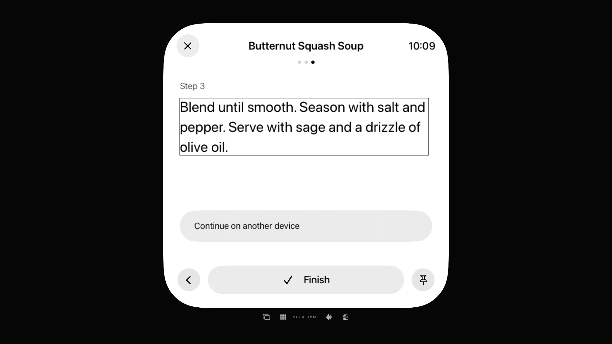

# TV-Rezept: Schritt und Anleitung per VoiceOver-Remote

30. Oktober 2026 · [#73](https://github.com/Olli0103/homeview/issues/73) bleibt offen; F103 partial/parity=false.

**Tatsächliche Lücke korrigiert:** Die normale Rezeptnavigation funktioniert bereits, der unveränderte native TV-VoiceOver-Fall erreicht aber den Schritttext nicht per Remote. Nur `CookingView` erhält für Schritt und Anleitung eine tvOS-bedingte Fokusfähigkeit über das echte öffentliche `accessibilityVoiceOverEnabled`-Environment. Der dekorative Fokuseffekt dieser Lesetexte ist aus; Layout, Schrift, Farben und andere Plattformzweige wurden nicht umgestaltet.

Der aktuelle native Fall öffnet aus „Recipes“ das gespeicherte eigene Rezept, startet Cooking und erreicht **1 → 2 → zurück zu 1 → 3 → Finish**. Alle 19 erforderlichen Fokus-/Sprachprüfungen und die tatsächlichen Remote-Select-Callbacks bestehen. Vollständige AX-Anleitungstexte werden separat gegen die eigene Fixture geprüft; bei der nativen Sprachmeldung sind kurze vorab deklarierte Ausschnitte verlangt, **keine vollständige Absatz- oder akustische Abnahme**. Vor wiederholtem Next wird der Schritt tatsächlich neu fokussiert; dies ist ein expliziter Leseweg, keine automatische Ansage auf bloße UI-Änderung.

## Getrennte aktuelle Ergebnisse

| Prüfung | Aktuelles Ergebnis |
|---|---|
| TV: normaler Rezeptablauf und nativer VoiceOver-Rezeptfall | 2 PASS |
| TV: zusätzliche native VoiceOver-Kamera-/Timer-Gegenkontrollen | 2 PASS |
| iPhone/iPad: vorhandene Rezept-/Zutaten-/Schritt-/Abbruchkontrolle | je 1 PASS |
| iOS, macOS, tvOS, visionOS, watchOS | 5 finale SDK-PASS, 77 Produktdateien zurückgelesen |
| Vier ganze normale TV-Bildpaare | **1 strikt PASS, 3 strikt FAIL / nicht abgenommen** |

Alle sechs aktuellen UI-Ausführungen verwenden denselben 253-Dateien-Quellpin; keine Skips oder strukturierten XCTest-Runtime-Warnungen. Die drei aktuellen nativen VoiceOver-Fälle stellen jeweils den ursprünglichen Aus-Zustand wieder her; die zusätzlich im eigenen Runner gespeicherten Berichte sind bytegleich zum jeweiligen Anhang. Pro UI-Build 18 TV-/33 mobile App-/Runner-/Launcheingaben archiviert und zurückgelesen; beide TV-Gegenkontrollen verwenden die exakten finalen kompilierten Eingaben ohne erneuten Build. iOS benötigt bei den SDKs eine bestehende normale Metadata-Clean-/Build-Wiederholung: Die erste Kompilierung meldet bereits Exit0, ihre generierten SSU-Dateien sind jedoch unvollständig. Dieser Metadatenfehler bleibt erhalten; erst die normale Wiederholung liefert die vollständigen geprüften Dateien. Kein zusätzlicher iOS-Compilerfehler wird erfunden. Drei neue SDK-Dateiversionen, übrige Bytes aus den gemeinsamen Archiven rekonstruiert.

Die 96 Core-/Package-/Testinputs sind exakt gleich zum belegten früheren 458-PASS-Lauf. Kein neuer Corelauf wird behauptet. 137 native PNGs vollständig dekodiert, zwölf Kontaktseiten und vier volle native Bilder gesichtet; zwei eigene Bilder veröffentlicht. Quellen und kompilierte Deltas wurden während der Ausführung nicht geändert; acht historische/aktuelle Quellpins sind vollständig aus gemeinsamen/differenziellen Archiven rekonstruiert. [Digests, Ergebnisse und Grenzen](verification/tv-recipe-voiceover-20261030.json) · [253 Quellinputs](verification/tv-recipe-voiceover-source-20261030.json).

## Die Bildgrenze bleibt unverändert streng

Vier vor der Produktänderung deklarierte ganze 1920×1080-Bildpaare verlangen null unterschiedliche RGBA-Pixel **und** gleiche PNG-Bytes. Die tatsächlichen Unterschiede sind **0 / 45.825 / 19 / 13 Pixel**; nur das erste Paar ist bestanden. Keine Maske oder höhere Toleranz wurde ergänzt. Alle 20 zusätzlich betrachteten Fenster-/Viewport-/Text-/Aktionsrechtecke stimmen exakt überein; das ist eine nachgelagerte Geometriediagnose, kein Ersatz für die gescheiterte Pixelbedingung.

Die große Abweichung erscheint auch bei zwei Läufen mit exakt denselben zwölf Appdateien und derselben normalen Methode: 45.824 Pixel unterscheiden sich zwischen diesen beiden aktuellen Produktaufnahmen. Die große Differenz ist damit nicht ausschließlich durch den Produktwechsel erklärt. Eine genaue Renderer-/Fokus-/Timingursache wird nicht behauptet. Die weiteren 19 beziehungsweise 13 Pixel bleiben ungeklärt. **Kein pauschaler Normalbild-, Original- oder Parity-PASS.**

## Historische Fehler bleiben erhalten

Zwölf UI-Ausführungen insgesamt: neun PASS, drei FAIL; darin eine gesonderte Rückstellungsdiagnose, keine zusätzliche Produktabnahme. Der vorausgehende einzelne UI-Test-Kompilierfehler wegen fehlender Actor-Annotationen zählt nicht als UI-Ausführung.

Der erste Rezeptlauf wählte fälschlich bereits auf der Rezeptliste „Start Cooking“. Ein interner Missing-Match-Snapshot-Abbruch übersprang trotz nichtfataler Assertioneinstellung das Swift-Cleanup. Ein unabhängiger nativer Getter stellte danach tatsächlich `true` fest und setzte auf den vorher aufgezeichneten Originalwert `false` zurück. Diese Diagnose bleibt außerhalb des ausgelieferten Standardtargets. Fehlende Pflichtziele werden nun vor Fokusabfragen kontrolliert abgefangen. Der erste qualifizierte Lesefall reproduziert anschließend die echte Schritt-Fokuslücke am unveränderten Produkt. Der erste Produktkandidat erreicht Texte bereits, scheitert aber separat bei der verlangten neuen Sprachmeldung eines weiterhin fokussierten Next-Buttons. Alle Fehler und ihre Quellen bleiben erhalten; der aktuelle tatsächliche Fokus-Rückweg ersetzt sie nicht rückwirkend.

Keine echte Home-/Account-/Mikrofon-/Kameranutzung, Systemalarme oder OS-Rezeptübergabe. Mobile Kontrollen öffnen nur die lokale Übergabeansicht und schließen sie ohne Offer/Transfer/Authentifizierung; es wird kein Timer erstellt. Physische-/Signingabnahmen bleiben pausiert. Weitere zentrale Hilfsmittelpfade, komplette lange Lektüre und die Bild-/Original-/Geräteabnahmen bleiben offen. Der Backlogauftrag wird mit dem nächsten zentralen Flow fortgesetzt.
