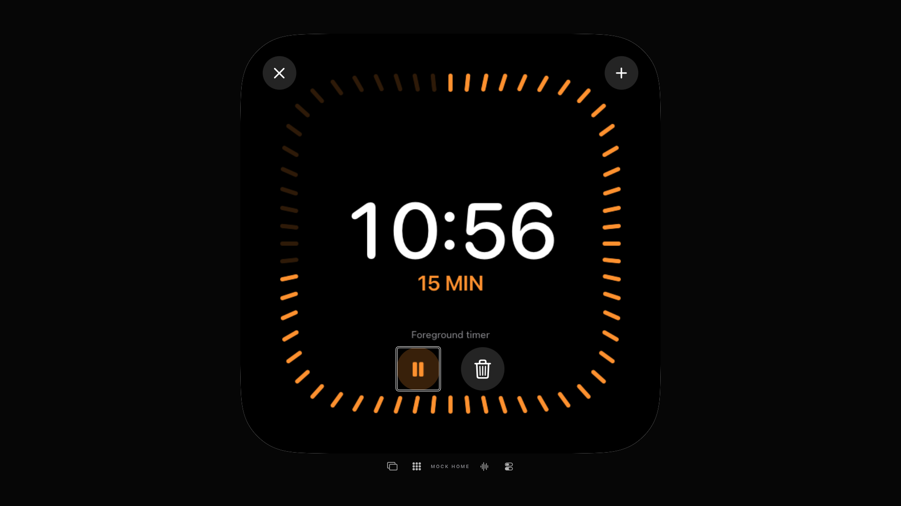

# TV-Timer: tatsächliche VoiceOver-Remote-Rückkehr

30. Oktober 2026 · [#73](https://github.com/Olli0103/homeview/issues/73) bleibt offen.

**Ein neuer vollständiger begrenzter Timer-Fall besteht:** Mit tatsächlich aktiviertem tvOS27-VoiceOver wird ein pausierter eigener Vordergrundtimer fortgesetzt, seine neue Pause-Aktion nach echter Nachbartasten-Navigation erneut vorgelesen, pausiert und gelöscht. Anschließend wird aus der Einrichtung ein neuer Timer gestartet, pausiert, seine geänderte Resume-Aktion erneut vorgelesen und wieder gelöscht. Alle Aktionen verwenden die tatsächliche Remote-Select-Taste am vorher exakt fokussierten Control; kein Systemalarm oder reales Gerät.

Zehn gemeldete Fokuswerte sind vollständig beobachtet: Resume, Delete, Pause, Delete, Start, Delete, Pause, Delete, Resume, Delete. Die ursprüngliche VoiceOver-Einstellung `false` wird wiederhergestellt und zurückgelesen. Der zusätzlich im eigenen Runner gespeicherte Bericht ist bytegleich zum XCTest-Anhang.

## Was dieser Fall nicht korrigiert oder ersetzt

Der [frühere unverändert erhaltene Fall](tv-voiceover-remote.md) verlangt nach Resume sofort „Pause timer“, ohne den bereits fokussierten Button tatsächlich zu verlassen. Das scheitert weiterhin im historischen Bericht. Der neue Fall ist ein **separater Bedienweg mit realem Fokuswechsel**, keine Umetikettierung dieses Fehlers und kein Nachweis einer automatischen dynamischen Ansage. Auch globales Next-Element-API-Traversal, akustische Abnahme, Originalreihenfolge und sämtliche übrigen zentralen Flows bleiben getrennt offen.

Keine Produktänderung war notwendig oder wurde geliefert. Nur die zusätzliche normale TV-UI-Testmethode ist neu. Alle bisherigen Methoden und alle Produktquellen sind unverändert; die zwölf aktuell installierten Appdateien stimmen exakt mit der zuvor akzeptierten nativen TV-App überein. Die 18 aktuellen kompilierten App-/Runner-/Launcheingaben sind archiviert/zurückgelesen und vor/nach Ausführung unverändert. **1 PASS, 0 FAIL, 0 Skip, keine strukturierten XCTest-Runtime-Warnungen.**

Zwölf native PNGs dekodiert und auf einer Übersicht gesichtet, die fortgesetzte Timeraufnahme zusätzlich in voller Größe. Zwei eigene Bilder veröffentlicht. Vorherige 458-Core-/Fünf-SDK-/77-Produktnachweise werden ausdrücklich nur als unveränderte historische Produktbasis verwendet, nicht als neue Ausführungen gezählt. [Aktuelle Quellen und Zahlen](verification/tv-timer-voiceover-refocus-20261030.json) · [253 Eingabedateien](verification/tv-timer-voiceover-refocus-source-20261030.json).

Home-/Account-/Geräte-/Signinggrenzen unverändert. F103 bleibt partial/parity=false; keine neue Issue-Schließung. Weiter zum nächsten noch offenen zentralen Hilfsmittelpfad.
