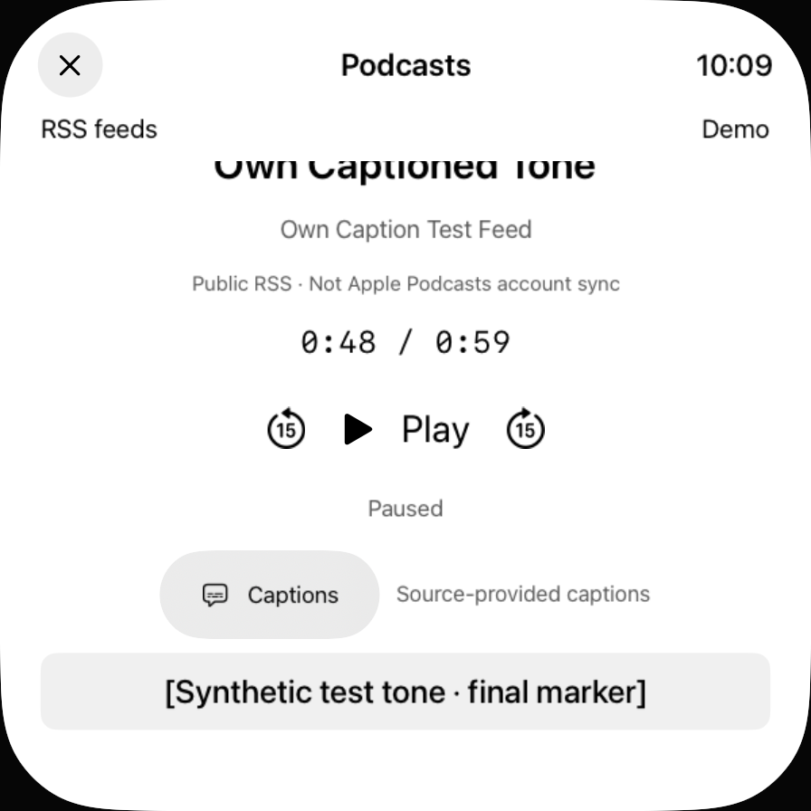

# Eigene Quelluntertitel auf TV und Vision

30. Oktober2026 · [#74](https://github.com/Olli0103/homeview/issues/74) bleibt offen; F104/F105 ohne Parity.

**Zwei getrennte native Vollfälle bestanden:** Vision zuerst bei Testpin caption2, TV nach zwei ausschließlich tvOS-bedingten Produktkorrekturen bei caption7. Kein gemeinsamer finaler Zweierlauf und keine Wiederholung des Vision-Laufs nach ausschließlich TV-bedingten Änderungen. Alle fünf finalen SDKs bestehen am letzten Quellenstand.

## Nachgewiesener eigener Umfang

Die bestehende stumme eigene Tone-/Timedtext-Fixture wird bewusst ausgewählt und erst durch Play geladen. Die Prüfungen erreichen tatsächlich ersten und letzten Cue, pausieren, schalten Off, springen zurück auf0 und vor auf45Sekunden und wechseln bewusst zur zweiten Quelle ohne Untertitel. Dort fehlen alter Cue und auswählbare Spur; die sichtbare Meldung lautet „No captions supplied by this episode.“ Keine fremden Medien, ASR, OS-Live-Captions oder breite Format-/Sprachabnahme.

Vision: drei actual virtuelle Kamerabilder liegen jeweils vollständig in ihrer zehnsekündigen nativen Haltephase. App-Snapshot-API-Ausschnitte werden nicht als vollständiges räumliches Fenster ausgegeben. Alle drei tatsächlichen Kamerabilder wurden gesichtet; die Apple-Umgebung bleibt privat.

## Zwei tatsächliche TV-Produktkorrekturen

1. Die Quelle liefert den Cue, aber sein AX-Rahmen lag vollständig unterhalb des eigenen Viewports: y1017,3 bis1102,4 bei Viewport-Unterkante968. Tatsächliches Vorherbild und AX-Baum bleiben erhalten. **Nur tvOS** erhält für den aktuellen Cue `.focusable()`. Remote-Fokus scrollt jetzt beide tatsächlichen Cues vollständig in den unveränderten Schnitt aus Viewport und Scrollbereich; kein Select auf dem Text.
2. Der folgende native Rückweg zur bereits vorhandenen RSS-Feedtaste scheiterte noch: Fokus blieb bei den Transporttasten, die seitlich versetzte Navigationszeile wurde nicht erreicht. Eine **nur tvOS**-Fokussektion für die bestehende volle HStack-Zeile überbrückt diese Lücken. Derselbe unveränderte caption6-Test besteht anschließend als caption7 vollständig bis Quellenwechsel/Pause. Kein neues Produktmenü, kein Layout-/Farbaustausch, keine neue Medienfunktion.

## Erhaltene Diagnosefehler

Acht tatsächliche Caption-Ausführungen: **zwei PASS, sechs FAIL**. Zusätzlich ein eigener TV-Testbuildfehler vor jeder Methode (Actor-Isolation), nicht als weitere UI-Ausführung gezählt. Vision scheiterte zunächst an einem Testhelfer, der die Toolbar zum Scrollinhalt zählte. Auf TV sitzt Fokus beim nativen Menü in einem tatsächlichen eigenen Kind; die Menüaktionen behalten ihre Kennungen als Other innerhalb einer fokussierbaren Cell. Der letzte Test bindet die exakte ID an ihre besitzende Zeile, nicht an vermutete Buttons oder Titel. Diese Hilfsfehler werden nicht als Produktfehler verkauft. Die zwei folgenden echten TV-Grenzen sind oben separat beschrieben.

[Einzelne Ergebnisse, Quellpins, Archive und Bilder](verification/tv-vision-source-captions.json). Alle acht tatsächlichen Quellen-/Compiler-/Kontrollarchive vollständig zurückgelesen, installierte eigene App/Runnerbytes geprüft, Quellen/Binaries während jedes Laufs unverändert. Der normale Store ist bei diesen Caption-Fällen durch eindeutige UITesting-Stores getrennt; die zuvor archivierte normale OS-Shortcut-Diagnose bleibt aus dem Standardtarget entfernt.

Fünf SDKs am aktuellen Quellenstand: vollständige73Produktdateien und242Quellinputs gehasht/extern archiviert/zurückgelesen. iOS benötigt einmal den bestehenden normalen Clean-/Metadata-Recoverypfad; Erstversuch bleibt separat. Der vorherige SDK-Zwischenstand umfasst69Dateien in fünf App-Bundles; der73er-Vergleich zählt zusätzlich vier separat gebaute Widget-Produktdateien außerhalb der Apps. Keine fehlende App-Metadatei aus diesem Zählunterschied erfunden. Core unverändert, der vorherige449er-Lauf wird nicht als neu ausgegeben.

Keine Systemhilfsmittel aktiviert/trainiert, realen Konten, Mikrofon/Kamera, Anrufe/Nachrichten oder Home. Geräte-/Signing-Pause unverändert. Sichtbarer Vision-OS-Warmaufruf und fünf ungeklärte OS-Pfade bleiben in der vollständigen48-Zellen-Matrix offen; **#74 wird nicht vorzeitig geschlossen.**
