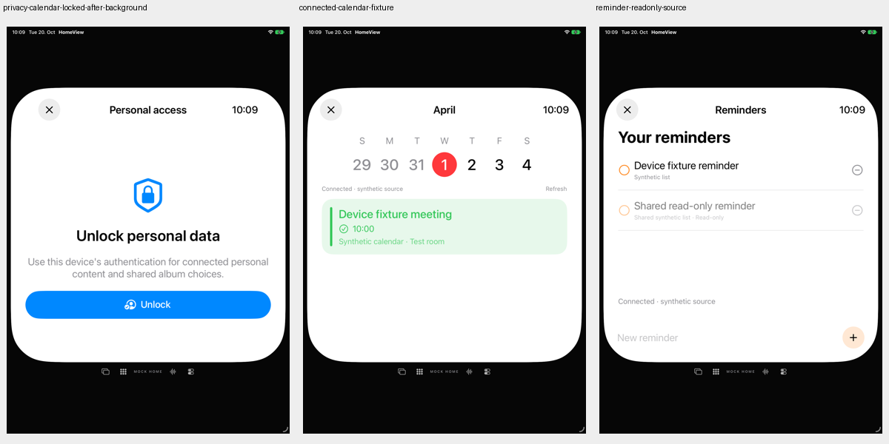
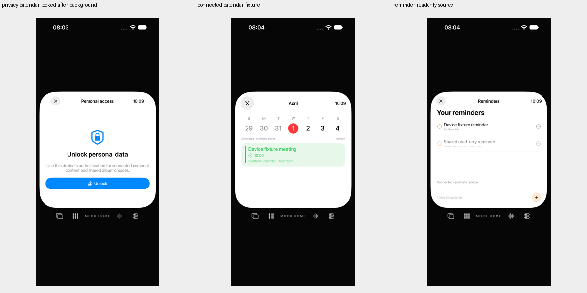

# Entsperranfragen an ihre Ansicht binden

20. Oktober 2026. Begrenzte Folgekorrektur für #67/#80; beide Gesamtissues bleiben offen.

## Verhalten

Die zentrale Entsperrfunktion verwirft seit [dem Vorab-Abbruchfix](unlock-pre-cancelled.md) bereits abgebrochene Aufrufer. `DeviceUnlockView` hielt ihren eigenen Task jedoch nicht fest. Er konnte nach dem Verlassen oder erneutem Tippen weiterlaufen. Außerdem prüfte der Callback nach der Antwort nur die Route: Ein entwerteter Aufrufer konnte während einer neueren Anfrage noch eine alte Fehlermeldung anzeigen.

Die Ansicht speichert nun ihren Task. Er wird vor einer Ersatzanfrage, beim Verlassen und bei `.background` abgebrochen. Vor dem Provider-Aufruf und nach seiner Antwort wird der Task-Abbruch geprüft. Alte Task-Abschlüsse verändern oder leeren keinen neueren Task-Slot. Ein erfolgreicher Zugriff wird durch das anschließende Verschwinden der Entsperransicht nicht wieder gesperrt.

`.inactive` ist ausdrücklich kein Abbruchgrund: Ein Systemdialog kann die App vorübergehend inaktiv machen. Auch die eingebettete Entsperrung innerhalb von Kalender/Erinnerungen bleibt zulässig, obwohl deren Route bereits `.app(...)` ist. Deshalb gibt es vor dem Provider-Aufruf **keinen** neuen `route == .deviceUnlock`-Guard.

Task-Abbruch und Unterdrückung alter Autorität sind nicht dasselbe wie das zeitnahe Schließen eines nativen `LAContext`-Dialogs. Eine solche Prompt-Abnahme wurde hier nicht vorgenommen.

## Nachweis und Grenzen

| Lane | Ergebnis |
|---|---|
| Native Callback-/Core-Gegenprobe vorher | 12 Szenarien / 40 Assertions; 6 Szenarien mit 8 fehlgeschlagenen Assertions |
| Dieselbe Gegenprobe nachher | 12 Szenarien / 40 Assertions bestanden |
| Tatsächliche UI-Regression | 4 Methoden je iPad/iPhone, insgesamt 8 erfolgreiche Ausführungen; keine Fehler, Skips oder von XCTest gemeldeten Runtime-Warnungen |
| SDK-Builds | iOS, macOS, tvOS, visionOS und watchOS erfolgreich |
| Neue Core-XCTest-Läufe | 0; Core- und Testquellen unverändert. Die 303 Tests des Elterncommits bleiben ein historischer Nachweis, kein neuer Lauf. |

Die native Gegenprobe kompiliert die tatsächlichen Corequellen und die aus der Produktquelle extrahierten Button-/Lifecycle-/Cancel-Körper. Nur ein `defer`-Abschlusszähler wird in den Task eingefügt; nach dessen Entfernung müssen die Callback-Bytes wieder exakt dem Produkt entsprechen. Probe und kontrollierter Provider sind vor/nach der Korrektur bytegleich. Der Owner, das Route-Modell und die Phasenereignisse sind **symbolische** MainActor-Testobjekte, keine tatsächliche SwiftUI-, AppModel-, RootView- oder Biometrie-Ausführung.

Geprüft werden: Verlassen vor Task-Eintritt, Verlassen einer laufenden Anfrage zu Face/Personal, Ersatz vor Eintritt, alte Fehler während/nach neuer Anmeldung, normaler Erfolg samt anschließendem Verlassen, eingebetteter Kalender-/Reminder-Zugang, aktuelle Ablehnung, inaktive Promptphase und Hintergrund mit Root-Sitzungssperre.

Die vorgelagerten Root-Grenzen wurden vorher separat aus der vollständigen Quelle abgeleitet: Profilauswahl sperrt; normales Navigieren zu Face/Personal entfernt nicht den gesamten Root; Hintergrund sperrt die Sitzung, ändert die reine `.deviceUnlock`-Route aber nicht. Das unterscheidet diese Fälle vom zuvor [widerlegten isolierten Gastmodus-Verdacht](unlock-pre-cancelled.md#verworfener-gastmodus-verdacht).

Die tatsächlichen UI-Tests prüfen erfolgreiche Kalender-/Reminder-Freigabe, eine abgelehnte synthetische Geräteanmeldung mit null Album-Permission-/Katalog-/Leseaufrufen und Hintergrund/Rückkehr mit frischer Freigabe. Sie enthalten **keinen** kontrolliert noch laufenden Systemdialog beim Verlassen oder Ersetzen einer Anfrage. App-/Testbundle und Startkonfiguration sind vor/nach unverändert; die installierten Simulator-Apps sind gegen den Build zurückgelesen. Sechs gespeicherte PNGs wurden decodiert und beide Kontakte gesichtet. Keine Original-Pixel- oder physische Snapshot-Abnahme.

## Quellenbindung

Ausgangscommit `a7bae1636b3191243291595c37947c1aefda8185`. Der einzige veränderte kompilierte Input ist `Sources/App/ConnectedViews.swift`. Core, Tests, Shared, Konfiguration und Ressourcen bleiben bytegleich. [207-Dateien-Manifest](verification/unlock-owner-source.json), Quelldigest `dfd1cdd8d326d6537a79d35d750ada29a5a484037b5d6daca1594ea7933daddd`.

[Einzelergebnisse, abgeleiteter Root-Vertrag, Fixture-Digests und Archivquittungen](verification/unlock-owner.json). Vier unverbundene `.swift.txt`-Dateien unter `Docs/verification` enthalten Probe, Provider und beide Callback-Stände; nur finale leere Zeilen der öffentlichen Textkopien sind normalisiert. Die exakt kompilierten Originalbytes bleiben in den getrennten Archiven erhalten.

Keine echte OS-Authentifizierung, Prompt-Schließungs-/Pending-SwiftUI-Abnahme, Präsenz-/App-Switcher-Snapshot- oder vollständige Identitäts-/Datenschutzabnahme. Keine Home-Anbindung, echten persönlichen Accounts/Daten, Kamera-/Mikrofonaufnahme, Nachrichten, Anrufe, Systemalarme oder tatsächliche Medienwiedergabe.

