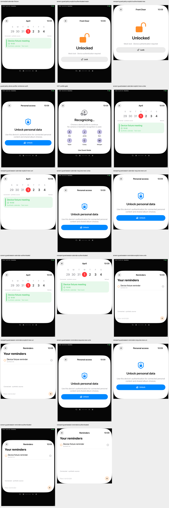
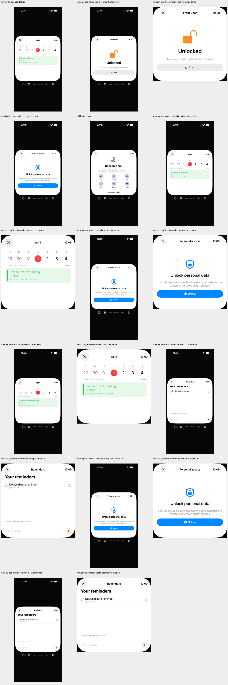

# Abbruch vor dem Beginn einer Geräteanmeldung

20. Oktober 2026. Begrenzte Korrektur für #67/#80; beide Gesamtissues bleiben offen.

## Tatsächlicher Fehler und Korrektur

`DeviceConnections.unlock()` prüfte einen Task-Abbruch erst **nach** dem Provider-Aufruf. Eine schon vor Eintritt abgebrochene Anfrage konnte deshalb trotzdem den Authentifizierungsprovider aufrufen und `unlockGeneration` erhöhen. Anschließend konnte ihre Abbruchbereinigung eine bereits gültige Sitzung samt Kalender-/Erinnerungscache löschen oder eine andere, berechtigt laufende Anmeldung entwerten.

Eine Abbruchprüfung steht jetzt vor Generationswechsel und Provider-Aufruf. Ein schon abgebrochener Aufrufer gibt `false` zurück, ohne Prompt-Anforderung, neuen Anspruch auf die Sitzung oder Bereinigung einer fremden Anmeldung. Die bisherigen Prüfungen nach der Providerantwort bleiben erhalten. Dies ist keine pauschale Zusicherung, dass laufende Systemprompts jederzeit abgebrochen werden können.

Die einzige Produktänderung ist diese Prüfung samt Kommentar in `Sources/Core/ConnectedDataSession.swift`. Es gibt keine Änderung am Gastmodus oder an der Oberfläche.

## Getrennte Nachweise

| Prüfung | Vorher | Final |
|---|---|---|
| Tatsächliche Corequelle, kontrollierter synthetischer Provider | 4 Szenarien / 14 Assertions; 3 Szenarien mit 7 fehlgeschlagenen Assertions | 4 Szenarien / 14 Assertions bestanden |
| Vollständiges Core-XCTest-Paket | Kein neuer Gesamtlauf am Vorherstand | 303 Tests, keine Fehler oder Skips |
| Tatsächlicher Gast-UI-Weg auf iPad/iPhone | Je 2 Tests, insgesamt 4 erfolgreiche Ausführungen | Enthalten im finalen Lauf |
| Finaler UI-Prüfstand | — | Je 4 Tests, insgesamt 8 erfolgreiche Ausführungen; keine Fehler, Skips oder von XCTest gemeldeten Runtime-Warnungen |
| SDK-Builds | — | iOS, macOS, tvOS, visionOS, watchOS erfolgreich |

Die native Gegenprobe verwendet dieselben bytegleichen Provider- und Probe-Dateien vor/nach der Korrektur. Der Provider stammt aus der bestehenden synthetischen Testquelle; ergänzt wurde nur ein Aufrufzähler. Es werden die tatsächlichen Corequellen kompiliert, nicht eine nachgebaute Entsperrfunktion. Ein kontrolliertes Continuation-Paar prüft, dass eine abgebrochene Nebenanfrage die bereits laufende legitime Anmeldung nicht verdrängt. Die normale Anmeldung bleibt als Kontrolle erfolgreich. Zwei neue XCTest-Methoden decken den vorab abgebrochenen Eintritt bei gesperrter/entsperrter Sitzung und während einer anderen laufenden Anmeldung ab.

Die UI-Tests prüfen den normalen Zugang, die Trennung zwischen Demo-Profil und Gerätefreigabe, den tatsächlichen Profilwahl-/Gastweg für Kalender und Erinnerungen sowie die bestehende Mock-Schloss-Grenze. Sie reproduzieren **nicht** den vorab abgebrochenen Task über echte Systemauthentifizierung. App-/Testbundle und Startkonfiguration wurden vor/nach den Läufen verglichen; die installierte App stimmt je Simulator mit dem Build überein.

58 gespeicherte PNGs beider Prüfstände wurden decodiert; beide Kontakte des Vorherstands und beide des finalen Stands wurden gesichtet. Alle zwölf vergleichbaren Kalender-/Erinnerungs-Viewports sind bei gleicher eingefrorener Zeit vor/nach der Änderung exakt RGBA-identisch. Das ist Zustands-/Regressionsnachweis, keine Original-Parität oder physische Snapshot-Abnahme.

## Verworfener Gastmodus-Verdacht

Ein früher isolierter AppModel-/Gastcallback-Versuch ließ die vorgelagerte `RootView.onChange(route == .privacy)`-Sperre aus. Seine fünf fehlgeschlagenen Szenarien mit 15 Assertions je Diagnoselauf sind **keine bestätigten Produktfehler**. Auch der Wiederentsperr-Kontrollfall wurde vor einer Produktänderung um die tatsächlich benötigten expliziten Refresh-Aufrufe ergänzt. Initialer und qualifizierter Diagnoseversuch bleiben getrennt erhalten.

Der vollständige Quellabgleich und vier tatsächliche UI-Ausführungen am unveränderten Produkt widerlegen diesen Gast-Leck-Verdacht. Deshalb wurde kein Gastmodus-Fix eingeführt. Der nachgewiesene Abbruchfehler in `DeviceConnections.unlock()` ist davon unabhängig.

## Quellenbindung und Grenzen

[Receipt, einzelne Ergebnisse und Archivdigests](verification/unlock-pre-cancelled.json), [207-Dateien-Quellenmanifest](verification/unlock-pre-cancelled-source.json). Ausgangscommit: `7008855a8b2547a22cac64424c06a4bc5e262b91`; geprüfter Quelldigest: `02c5895f84c00b55d79447affa92d9294a7f0aa58bde24b8f3d603514618e02e`. Dokumentation und Fortschrittsmetadaten verändern diesen Code-/Test-/Ressourcenstand nicht.

Die zwei neuen Corefälle können mit `swift test --filter DeviceConnectionTests.testPreCancelledAuthentication` wiederholt werden. Die zusätzliche unabhängige Probe und ihr Provider sind als unverbundene `.swift.txt`-Dateien unter `Docs/verification` erhalten.

Keine echte OS-Authentifizierung oder Promptmessung, kein tatsächlicher SwiftUI-Abbruch beim Verlassen einer noch laufenden Entsperrseite, keine physische Präsenz-/App-Switcher-Snapshot-Abnahme und keine vollständige Identitäts-/Medienpolicy wurden hier geprüft. Keine Home-Anbindung, echten persönlichen Accounts/Daten, Kamera-/Mikrofonaufnahme, Nachrichten, Anrufe, Systemalarme oder tatsächliche Medienwiedergabe.

