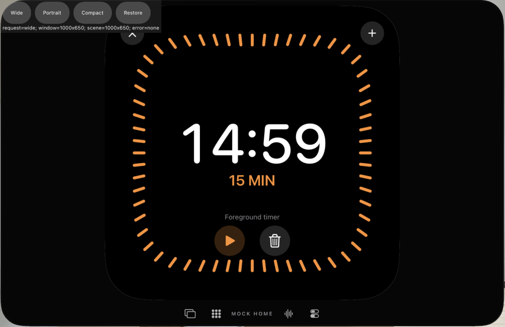
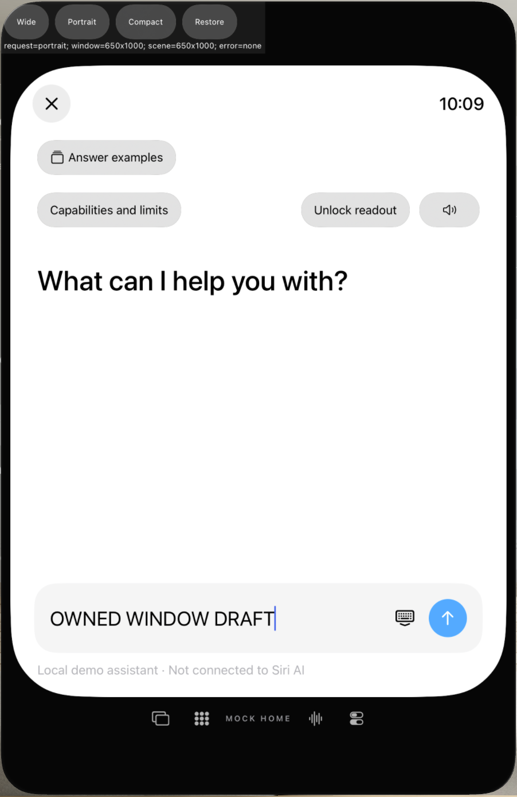
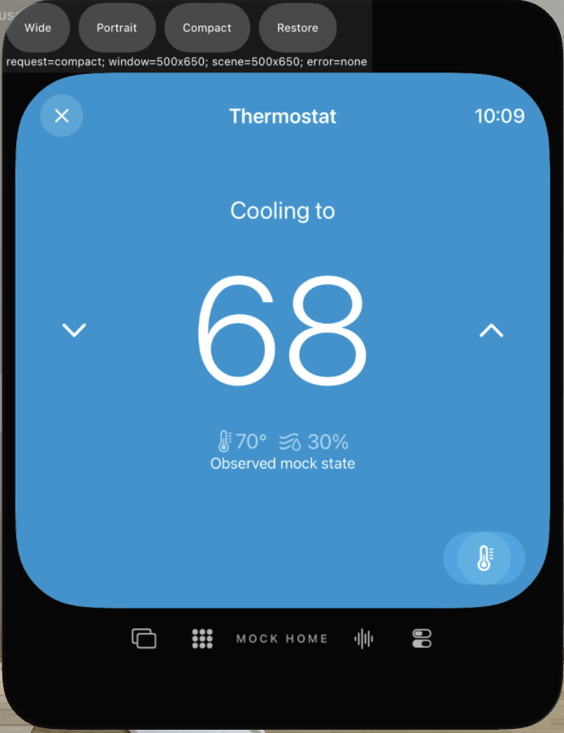
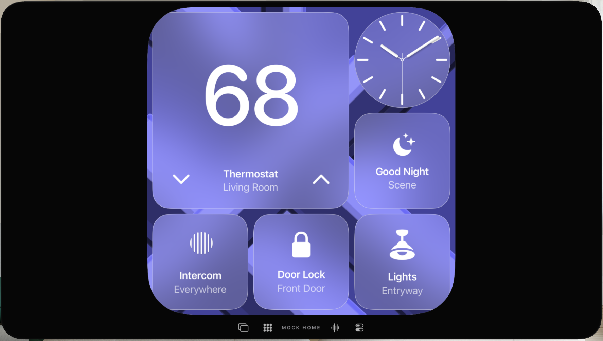
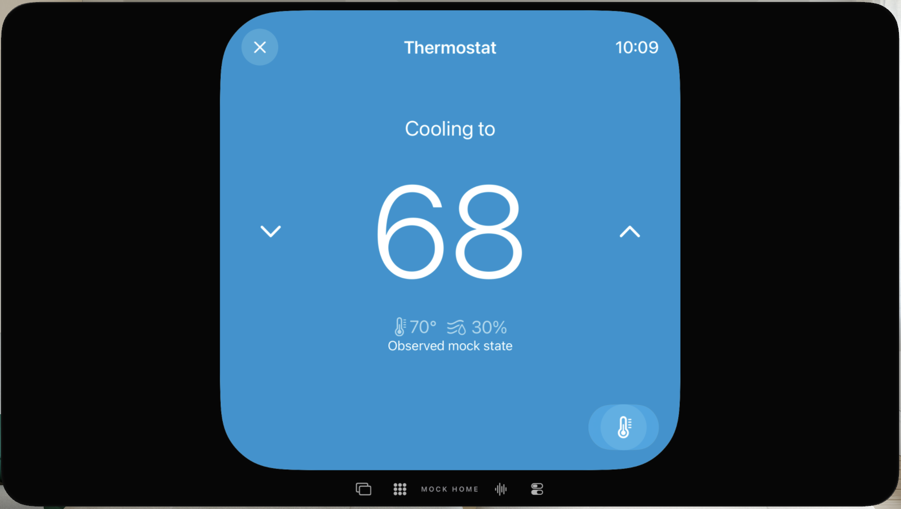

# visionOS: tatsächliche Fenstergrößen und zusammenhängende Eingabe

31. Oktober 2026 · Teilumfang von [#79](https://github.com/Olli0103/homeview/issues/79).

Zwei aktuelle native Methoden bestehen auf dem eigenen Vision-Pro-4K-Simulator,
visionOS27.0/24M362: **zwei Ausführungen, keine Fehler, Skips oder strukturierten
Runtime-Warnungen**. SDK-/Debuggerhinweise im Rohlog bleiben separat erhalten.
Kein Rendererfix, keine physische Headset- oder Originalabnahme.

## Tatsächliche OS-Größen, nicht injizierte View-Geometrie

Der neue ausschließlich visionOS-bedingte Diagnosepfad ist nur bei gleichzeitigem
`--uitesting`, `--vision-window-system-test` und gültigem eigenen UUID-Speicher
sichtbar. Ein nicht interaktiver UIKit-Anker bindet genau sein eigenes Fenster.
Die öffentliche `UIWindowScene.requestGeometryUpdate(.Vision(size:))` verändert
dessen OS-Szene; kein Ersatz-GeometryReader, keine geänderten Minimum-/Maximum-
Größen oder Resizing-Restrictions. Die geprüften öffentlichen SDK-Header bleiben
privat, ihre Digests sind im Bericht gebunden.

| Angefordert und tatsächlich zurückgelesen | Zusammenhängend geprüft |
|---|---|
| 1000×650 | Lokalen Timer starten/pausieren; Pause bleibt nach Änderung erhalten |
| 650×1000 | Ungesendeten eigenen Entwurf vor Änderung eingeben und danach exakt erhalten |
| 500×650 | Footer/Viewport innerhalb des gemeldeten AX-Fensters; tatsächlicher Tap öffnet68°-Mock-Thermostat |
| 1280×720 | Ursprüngliche Größe ausdrücklich im Teardown zurückstellen und zurücklesen |

Sowohl `UIWindow.bounds` als auch `effectiveGeometry.coordinateSpace.bounds`
liefern die geforderte tatsächliche Größe ohne Fehler. Gemeldete AX-Wrapperrahmen
können dagegen Aktivierungs-/Keyboardpadding enthalten und werden **nicht** als
identische logische OS-Inhaltsgröße ausgegeben. Zusätzlich sind alle drei
vollständigen virtuellen Kamerabilder tatsächlich gesichtet: Timer, eigener
Entwurf, Mock-Thermostat und Footer bleiben sichtbar. Danach führt echte Navigation
zum noch pausierten Timer zurück und löscht genau diesen lokalen Testtimer.
Es wird nichts gesendet, kein Audio abgespielt und kein Systemalarm erzeugt.

Ein zweiter bestehender nativer Fenster-/Thermostatfall startet synthetisch
**ohne Größen-Testflag**. Beide AX-Bäume enthalten keine Diagnosecontrols; beide
vollen Kamerabilder zeigen den eigenen normalen Viewport und den durch echten
Tap geöffneten Thermostat. Das ist kein signierter Normalbetrieb mit persönlichen
Daten. Home-, Geräte- und Signing-Holds bleiben bestehen.

## Nachweise und ursprünglicher Fehlstand

Der erste Lauf sucht das Timer-Icon vor der vorhandenen All-Apps-Seite und
scheitert vor jeder Größenänderung. Dieser methodische **FAIL** bleibt erhalten.
Nur die Testnavigation wird korrigiert; alle14Appdateien sind zwischen diesem
Fehlstand und beiden aktuellen Methoden exakt gleich. Keine Produktstörung aus
einem falschen Testweg abgeleitet. Historie: drei Ausführungen, zwei PASS/ein FAIL;
zwei eindeutige aktuelle Methoden, davon eine neu.

266 Quellen,20kompilierte App-/Runner-/Startdateien, jeweils14installierte
Appdateien und die wiederhergestellte Szene sind gebunden. Quellenbasis plus
Delta und beide tatsächlichen UI-Pakete vollständig rekonstruiert/zurückgelesen.
Fünf vollständige3840×2160Kamerabilder und fünf unskalierte eigene Fenstercrops
sind gesichtet. Alle Aufnahmen liegen vollständig innerhalb ihres jeweils
markierten10-Sekunden-Zustandsfensters. Die bekannten abgeschnittenen XCTest-
Appbilder ersetzen diese sichtbaren Systemaufnahmen nicht.

Nur der betroffene normale Vision-SDK-Build wird über den bestehenden gemeinsamen
Builder mit16-GiB-Speicherreserve neu geprüft: PASS,14Dateien archiviert/read-back.
Sein Assetkatalog unterscheidet sich vom UI-Build;13/14Dateien stimmen überein,
beide Produkte bleiben separat gesichert. Keine Shortcut-Laufzeitabnahme aus
vorhandener Aktionsmetadatei. Core/Coretests unverändert; keine redundante
Core- oder Vier-Plattform-Suite. Deren vorige fünf-SDK-Lieferung bleibt separat
am Commit `a5fb035` datiert, nicht als neuer Lauf umetikettiert.

[Fristen, Quellen, Ausführungen, Archive und Bildbindungen](verification/vision-window-resizing-20261031.json).

## Eigene unskalierte Fenstercrops

Die folgenden Bilder sind ausschließlich Ausschnitte der tatsächlich gesichteten
virtuellen Kameraaufnahme, ohne Skalierung/Perspektivkorrektur. Größen sind logische
OS-Punkte, keine Behauptung, dass der perspektivische Crop dieselbe Pixelgröße hat.

## Offen

Programmgesteuerte öffentliche OS-Anforderungen sind keine physische Eckengeste,
Blick-/Handtracking-, räumliche Mehrfenster-, Warm-Shortcuts-, ältere OS-, echte
Dienst-/Account- oder Geräteabnahme. Mac-/TV-/Watch-/weitere Eingabegrenzen bleiben
separat. Keine Kamera-/Mikrofon-/Foto-/Musikquelle, Home-Anbindung oder echte
Nachricht/Anruf. **#79 bleibt OPEN**, ursprüngliche Aufgaben und Abnahme unverändert.
