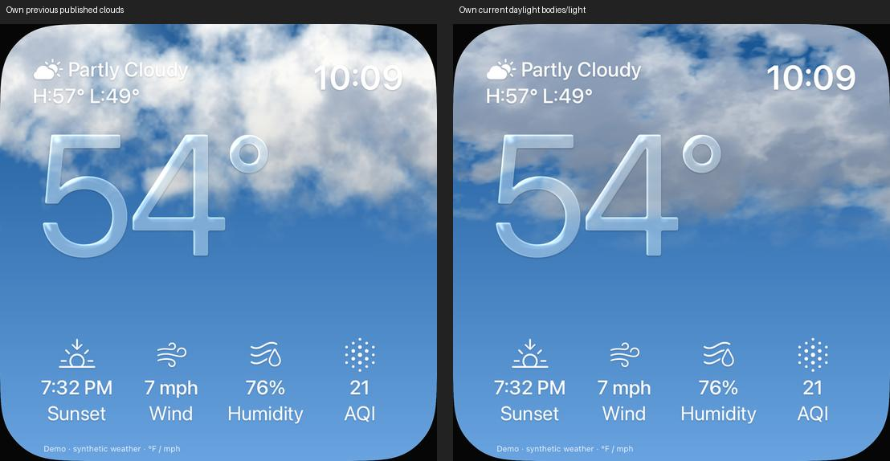

# Tageswolken: Körper und gerichtete Eigenverschattung

18. Oktober 2026 · [FACE-12 / #21](https://github.com/Olli0103/homeview/issues/21).
Integriert in [84d87fd](https://github.com/Olli0103/homeview/commit/84d87fd9dd3a46c6db2a32672a35caeada8e888f).
Begrenzter eigener Renderer-Schritt, keine Originalabnahme.

## Bildbefund und Korrektur

Der vorherige strukturierte Himmel wirkte im privaten UI05-Vergleich zu fleckig
und gleichmäßig hell. Die eigene Tagesdichte verwendet nun gröbere, windgescherte
Koordinaten und dichtere Körper. Zwei feste Lichtproben und interne Dämpfung
unterscheiden helle Ränder und schattigere Wolkenkörper. Eine erste feinere Form
und ein danach zu heller Körper wurden vor dem finalen Freeze nach Bildprüfung
zurückgestellt. Ihre Pilot-PASS zählen nicht als finaler Stand.

Die alte obere Ausblendzone bleibt erhalten. Nachtparameter und Nacht-Dichtepfad
bleiben unverändert; diese Quellgleichheit ist kein nächtlicher Originalpixel-PASS.
Gemeldete null Prozent Bedeckung umgehen die Wolken weiterhin vollständig.
Hintergrund und Glas benutzen dieselbe Szene und Phase. Himmelspalette,
Zifferngeometrie und Quellendatenlogik werden nicht geändert. Die Beleuchtung
ist eine Illustration, keine echte gemessene Sonnenposition.

16 feste Tiefenproben, je zwei Schattenproben; keine datenabhängig unbeschränkte
Schleife. Die zusätzliche Lichtprobe ist trotzdem kein Beleg gleicher Laufzeit
oder Energie auf Hardware. Nur eigene Metal-/öffentliche SwiftUI-APIs, keine
Originaltexturen, Originalshader, privaten Frameworks oder neuen Pakete. Die
bereits geprüfte allgemeine Effektbibliothek ersetzt diesen Wolkenrenderer nicht.

## Quellengebundene Prüfung

139 Modelltests, erneut nach Feature- und Integrationscommit. Neun gezielte Fälle
je iPad und iPhone ergeben 18 Ausführungen ohne Fehler, Skips oder Runtime-Warnungen.
Demo/verbundene Werte ohne erfundenen AQI, unbekannte Werte/Einheiten, getrennte
Wetter-App und Navigation, Wolken-/Glasbewegung und Reduce Motion, null Prozent,
Nacht/veraltet/offline und Regen/Schnee sind enthalten. Alle fünf SDKs kompilieren.
Kein neuer vollständiger UI-Suite-PASS und keine physische Laufzeitabnahme.

Die vorab in den Tests festgelegten dekodierten RGBA-Regionen von Himmel und Glas
ändern sich im bewegten Positivfall auf beiden Geräten. Reduce Motion verändert
auf beiden Geräten jeweils null Kanäle. Tatsächliche Bilder beider Größen wurden
gesichtet. Frühere Pilotfälle werden nicht zu den 18 Ausführungen addiert.

133 Quellen vor/nach Lauf sowie gegen Feature-/Integrationsbytes identisch:
SHA-256 cdf3ae8ffe870d20c365fe5c8fe8545e6af5078248f0f667c34579597a1a40a6. Nur WeatherClouds.metal unterscheidet sich vom belegten
Kalender-UI08-Quellstand. Keine Kalender-/Foto-/Album-Logik geändert.

[Prüfbeleg und Pixelzahlen](verification/weather-body.json),
[Quellenmanifest](verification/weather-body-source.json),
[Bildmanifest](screenshots/goal-20261018/weather-body-manifest.json),
[Herkunft des eigenen Vergleichs](screenshots/goal-20261018/weather-body-own-comparison.json).

## Offen

Genaue Originalwolken, Licht-/Strömungsphase, Brechung, weitere Originalzustände
und Übergänge, Regen-/Frostgeometrie und physische Leistung bleiben offen. #21
bleibt offen. Nur synthetische Daten; keine echten Homes, Accounts, GPS- oder
Bibliothekszugriffe. Der private Originalvergleich wird nicht veröffentlicht.
