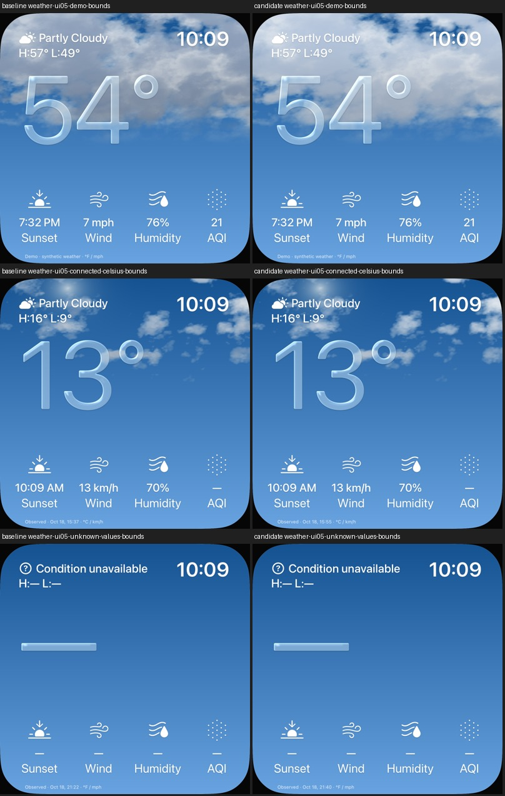

# UI05: hellere Tageswolken-Schatten

18. Oktober 2026 · [FACE-12 / Issue 21](https://github.com/Olli0103/homeview/issues/21).
Begrenzter eigener Farbschritt, keine vollständige Originalabnahme.
Code: [4b647666](https://github.com/Olli0103/homeview/commit/4b647666d8f57474d62620d96336ef50eb35e4c5).

## Korrektur

Im direkten privaten UI05-Vergleich waren freie Tageswolkenbereiche deutlich dunkler
als die Referenz. Nur der Tages-Schattenfarbton wird von der bisherigen Basis
(0,45/0,54/0,67) auf (0,64/0,72/0,83) angehoben. Der Nachtpfad behält die alte Basis.
Dichte, Wolkengeometrie, gerichtete Lichtberechnung, Zeitphase, 16 Tiefenproben,
Himmelspalette, Brechung, Daten und Layout bleiben unverändert. Glas und Hintergrund
verwenden weiterhin dieselbe eigene Szene. Keine Originaltexturen/-shader oder neuen Pakete.

## Vorab begrenzte Bildprüfung

Zwei freie UI05-Bereiche: x5–95%/y18–23% und x72–92%/y20–35%.
Verglichen wird nominelles RGB-Y (`0,2126R + 0,7152G + 0,0722B`), keine kalibrierte
Leuchtdichte. Je Bereich und Gerät: Medianabweichung höchstens12 Einheiten,
mindestens halbierte vorherige Abweichung und mindestens65% der Referenz-Kontrastspanne
zwischen10. und90.Perzentil. Alle Grenzen standen vor der ersten Änderung fest.

Die ursprünglichen iPad-Medianabweichungen37,9/33,1 sinken auf10,3/5,9;
auch das iPhone erfüllt alle Grenzen. Das sind ausschließlich diese Farbmetriken,
keine Prozentangabe für allgemeine Originaltreue. Ein erster Pilot verfehlte mit
13,7862 die unveränderte12er-Grenze im ersten Bereich und wurde nicht übernommen;
sein Quell-/Binär-/Bildbefund bleibt privat erhalten. Die nachfolgende kleine
Farbkorrektur erfüllte dieselben Grenzen. Piloten zählen nicht zu den22 Abschlussläufen.

## Unveränderte Regionen und Bewegung

Nacht und null Prozent Bedeckung bleiben in den oberen94% des nativen Face-Viewports
auf beiden Geräten **RGBA-exakt, null geänderte Pixel**. Die vorab ausgeschlossenen
untersten6% enthalten laufabhängige Beobachtungszeit/Quellenzeile. Bei Demo, Celsius
und unbekannten Werten bleibt der untere Tagesbereich y58–94% ebenfalls exakt.
Die Baseline reproduziert die bereits geprüfte App6750246c und ihre Atlasbilder.
Das ganze iPad-Demobild ist außerdem RGBA-exakt zum bestandenen zweiten Pilot.

Die festgelegten Himmel-/Glas-ROIs zeigen Bewegung im Positivfall und exakt null
Änderung mit CLI-Reduce-Motion. Keine RGB-Toleranz für diese Exakt-/Stabilitätsvergleiche.
Kein neuer tatsächlicher OS-Reduce-Motion-Schalter-Nachweis.

## Quellengebundene Prüfung

166 Modelltests,22 gezielte native Ausführungen (elf je iPad-/iPhone-Simulator),
null Fehler,Skips oder XCTest-Runtime-Warnungen. Zusätzlich je zwei Baselinefälle,
getrennt gezählt. Demo/verbundene Daten ohne erfundenen AQI,unbekannte Werte/Einheiten,
Layouts,Navigation,Bewegung/Reduce Motion,Nacht/veraltet/offline sowie Regen/Schnee
sind enthalten. Fünf SDKs kompilieren; das sind keine fünf Plattform-Laufzeitabnahmen.

142 Quellen identisch vor/nach Prüfungen und gegen Feature-/Integrationsbytes.
Nur Shader und ein zusätzlicher UI-Prüffall ändern sich;140 übrige Dateien bytegleich.
Dasselbe bereits gebaute Prüfbundle wird über Baselines,Piloten und Abschluss
verwendet; seine UI-Quelle bleibt bytegleich. Alle erwarteten installierten
App-Dateien je Lauf SHA-rückgelesen. Vollständige33 App-/Runner-/Parameter-Eingaben
unverändert und privat eindeutig archiviert/bytegeprüft.

Alle78 eigenen PNGs (58 Kandidat,20 Baseline) sind dekodiert und auf16 Kontaktbögen
tatsächlich gesichtet. [Nachweis](verification/weather-day-shadow.json),
[Quellen](verification/weather-day-shadow-source.json),
[eigene Bilder und Hashes](screenshots/goal-20261018/weather-day-shadow-manifest.json).
Keine privaten Originalbilder veröffentlicht. Nur synthetische Daten/MockHome,
keine echten Konten,Standorte,Bibliotheken,HomeKit-Geräte oder Kommunikation.

## Offen

Exakte Originalwolken/-phase,Schrift,Brechung,Lichtstrahlen,weitere Originalzustände,
Übergänge,Farbverwaltung/HDR,physische Leistung und Energie bleiben offen.
Dieser Farbschritt schließt Issue21 nicht und ist kein neuer Gesamtsuiten-PASS.
