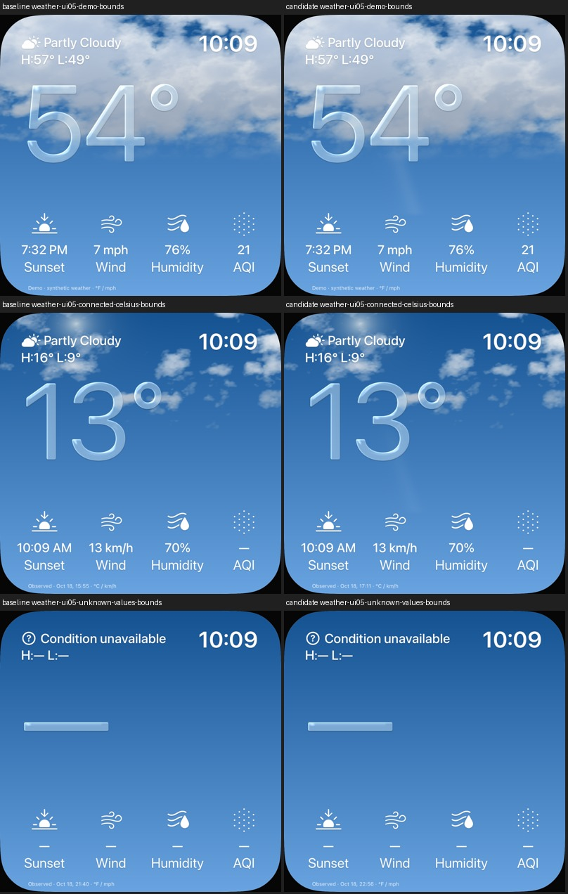

# UI05: eigene Lichtspur als getrennte Zeichenebene

18. Oktober 2026 · [FACE-12 / Issue21](https://github.com/Olli0103/homeview/issues/21).
[Code b7990d93](https://github.com/Olli0103/homeview/commit/b7990d9398c31524c6329ca890a8790598e17f8b).
Begrenzte Bildschirmillustration, keine vollständige Originalabnahme.

## Änderung

Die im UI05-Vergleich fehlende schmale Aufhellung unter der Temperatur wird durch
zwei eigene weiche Gaußprofile ergänzt. Eine transparente, vormultipliziert weiße
Ebene liegt über dem Wetter-Face; außerhalb ihres Trägers liefert sie exakt null.
Sie ist nicht interaktiv und nicht als zusätzliches Accessibility-Element sichtbar.
Der bisherige Wolken-/Glasshader bleibt **bytegleich**. Keine zusätzlichen
Dichteproben, keine Originalbilder/-shader/-fontkonturen und keine neuen Pakete.

Das ist eine bildschirmgebundene Illustration, **keine neu implementierte
Wolken-Tiefenverdeckung, Sonnenphysik oder richtungsabhängige Glasbrechung**.
Hintergrund und Glas erhalten dieselbe Bildschirmaufhellung; deren neue optische
Brechung bleibt ausdrücklich offen.

## Unveränderte, vorab festgelegte Grenzen

Fünf freie Himmelprofile bei y55/58/62/66/69%: nominelles RGB-Y
(`0,2126R + 0,7152G + 0,0722B`), Peakabweichung zur privaten Referenz höchstens3,
Peak mindestens4 sowie Lage/Halbwertsbreite höchstens2,5% Bildbreite entfernt.
Normierung auf544 Pixel, fünf Pixel horizontale Glättung und feste freie Flanken.
Auf beiden Simulatoren erfüllt. Keine kalibrierte Leuchtdichte-/HDR-/Farbverwaltung
und keine allgemeine Originaltreue-Prozentangabe.

Nacht und null Bedeckung bleiben oben94% **RGBA-exakt, null geänderte Pixel**.
Bei Demo/Celsius/fehlenden Werten sind alle Pixel außerhalb x25–61%/y32–75%
innerhalb oben94% exakt erhalten, ebenso beide zuletzt korrigierten Wolkenfarbregionen.
Die untersten6% mit laufabhängigen Beobachtungs-/Quellenzeiten waren vor dem ersten
Code ausgeschlossen. Keine RGB-Toleranz und keine nachträgliche Grenzlockerung.

## Zurückgehaltene Versuche

Zwei Änderungen direkt im gemeinsamen Shader trafen die Lichtprofile, veränderten
aber jeweils einen Blaukanal-Pixel weit außerhalb der Spur. Beide bleiben
zurückgehalten; Quellen, Binärpakete und Fehlerbefunde sind exakt archiviert.
Eine Vorgänger–Kandidat–Vorgänger-Kontrolle zeigte bei jeweils identischem Paket
exakte Wiederholbarkeit: nur der Kandidat reproduzierte den Fremdpixel.
Das grenzt den Befund ein, beweist aber keinen genauen GPU-Compilermechanismus.
Die getrennte Ebene erfüllt dieselben ursprünglichen Grenzen.

## Prüfung und offene Abnahmen

166 Modelltests, 22 gezielte native Fälle (elf je iPad-/iPhone-Simulator), null
Fehler/Skips/XCTest-Runtime-Warnungen, fünf SDK-Builds. Zusätzlich zwei iPad- und ein
iPhone-Pilotfall; Piloten und drei Diagnosefälle werden nicht zu22 addiert.
Bereits bestandene unmittelbare Vorgängerbilder wiederverwendet, kein zusätzlicher
Baseline-Abnahmelauf. Dasselbe gebaute Testbundle und unveränderte UI-Quelle.
Installierte App-Dateien auf beiden Geräten SHA-exakt;34 vollständige Eingaben
unverändert und privat eindeutig archiviert/bytegeprüft.

143 Quellen vor/nach Prüfungen und gegen Integrationsbytes exakt. Faces.swift,
neuer Shader und erzeugtes Projekt ändern sich;140 bisherige Dateien bleiben exakt.
Alle78 eigenen PNGs (58 Kandidat,20 vorher) auf 16 **verschiedenen** Kontaktbögen
wirklich gesichtet. iPad-Demobild RGBA-exakt zum bestandenen Pilot. Festgelegte
Himmel-/Glas-ROIs zeigen Bewegung und mit CLI-Reduce-Motion exakt Stillstand;
kein neuer tatsächlicher OS-Schalter- oder erodierter Glyphkörper-Nachweis.

[Nachweis](verification/weather-light-overlay.json),
[Quellen](verification/weather-light-overlay-source.json),
[eigene Bilder und Hashes](screenshots/goal-20261018/weather-light-overlay-manifest.json).
Private Originalbilder bleiben privat. Nur synthetische Daten/MockHome; keine echten
Konten, Bibliotheken, HomeKit-Geräte oder Kommunikation.

Exakte Originalwolken/-phase, Schrift, neue Lichtverdeckung/Brechung, weitere Zustände
und Übergänge, Farbverwaltung/HDR, physische Leistung und Energie bleiben offen.
Fünf SDK-Builds sind keine fünf Plattform-Laufzeitabnahmen. Issue21 bleibt offen;
kein Gesamtsuiten-,vollständiger Original- oder Hardware-PASS.
