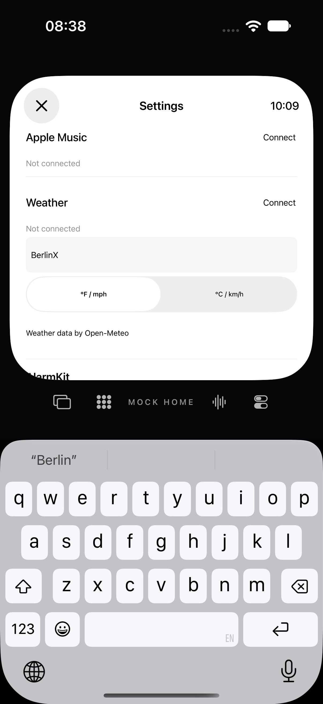
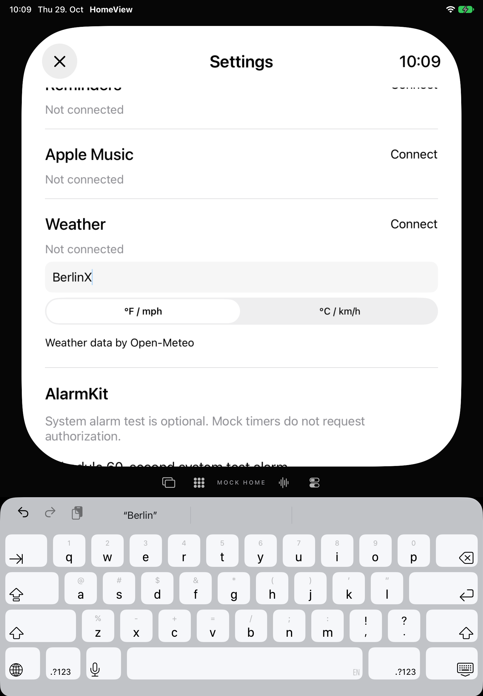

# Wetter-Einstellungen: Trefferflächen und sichtbare Eingabe

Separater Folgestand: [Wetter-App und Stadtdialog](weather-surface-hit-regions.md). Die folgenden Angaben einschließlich der damals unveränderten unskalierten Picker bleiben ihrem historischen Stand zugeordnet.

29. Oktober 2026 · begrenzter Teilfix von [#73](https://github.com/Olli0103/homeview/issues/73), Gesamtissue weiter offen.

## Reproduziert und korrigiert

Auf dem unveränderten veröffentlichten Produkt scheitern beide neuen Prüfmethoden auf beiden Simulatorgrößen. Die native Segmenthöhe beträgt nur 20,16 Punkte auf iPhone bzw. 42,45 auf iPad. Das Stadtfeld meldet zwar „hittable“, aber die echte Berührung zwei Punkte innerhalb seines oberen Randes liefert weder Tastatur noch Eingabefokus. Diese ersten Stadtfälle enden dort; ein vorher bestandener unterer Rand wird nicht behauptet.

Das Stadtfeld behält SwiftUIs öffentliche Texteingabe und ihren gebundenen Fokus. Sein umgebendes Rechteck stellt den Fokus tatsächlich her; die Mindesthöhe berücksichtigt die Skalierung der 600-Punkte-Leinwand. Die Einheitenwahl hostet nur hier den öffentlichen nativen UISegmentedControl in ausreichender echter Höhe. Das unskalierte Wetter-Sheet behält seinen bisherigen Picker; keine neue Schrift, Bibliothek oder private API.

| Native Höhe | iPhone vorher → nachher | iPad vorher → nachher |
|---|---:|---:|
| Stadtfeld vor Tastatur | 26,46 → 44,10 pt | 55,72 → 55,72 pt |
| Einheiten-Segment | 20,16 → 44,73 pt | 42,45 → 46,43 pt |

## Zusätzliche Bildkontrolle nach Tastaturöffnung

Der erste Kandidat besteht bereits zehn UI-Ausführungen und fünf SDK-Builds. Seine iPad-Aufnahme zeigt das bearbeitete Feld jedoch dicht am runden unteren Rand. Eine vor weiterer Produktänderung ergänzte Prüfung verwendet nach dem Tippen denselben sicheren Scrollbereich mit 40 Punkten vertikalem Abstand, der schon vor der Bearbeitung gilt. iPhone besteht, iPad scheitert an beiden Feldrändern: nur etwa 1,25 Punkte Abstand zwischen Feld- und Viewportunterkante.

Der Settings-ScrollViewReader bringt das Feld nun bei Fokus und bei geänderter Leinwandgröße in die Mitte. Im finalen iPad-Zustand liegt seine Unterkante rund 295 Punkte über der Viewportunterkante; die tatsächliche Tastatur und Texteingabe bleiben erhalten. Keine Änderung oder Lockerung der ursprünglichen Mindestflächen-, Auswahl-, Eingabe- oder Sichtbarkeitsprüfungen.

## Finaler Nachweis

**Zehn erfolgreiche UI-Ausführungen an denselben 225 Quelleingaben**, fünf eindeutige Methoden auf beiden Größen. Vier echte obere/untere Stadtrand-Eingaben und sechs Rand-Auswahländerungen der Einheiten. Zwei ungefilterte Hitflächen-Audits leer; bestehende Forecast-/Einheiten-/Stadtsheet- und späte-Antwort-Regressionen bestanden. 30 native PNGs dekodiert, vier Übersichten und zwei vollständige fokussierte Aufnahmen geprüft. Fünf SDKs bestanden. 88 Core-/Package-/Testdateien unverändert; kein neuer Core-Gesamtlauf.

Die früheren Stände bleiben separat: elf erfolgreiche und fünf fehlgeschlagene UI-Ausführungen, einschließlich vier ursprünglicher Vorherfehler und der später nachgewiesenen iPad-Fokuslücke. Der reine Testneubau erzeugte einen anderen Assets.car-Hash bei unveränderten Ressourcen; 18 übrige Produktdateien einschließlich Appcode blieben gleich. Dieser Zwischenstand wird ausdrücklich nicht als 19/19 byteidentisch ausgegeben. Alle ausgeführten Quellen, kompilierten App-/Test-/Launchdateien und Steuertexte sind je Stand archiviert/zurückgelesen; installierte Apps und unveränderte Eingaben geprüft.

Das ist keine vollständige Accessibility-, Hilfsmittel-, Hardware- oder Originalabnahme. Dynamic Type, Kontrast/Zoom, VoiceOver-/Voice-Control-/Switch-Control-/AssistiveTouch-Flows und weitere Oberflächen bleiben offen. Kein echtes Wetterkonto oder Standort, keine Home-Anbindung, Aufnahme, Wiedergabe, Alarmierung, Nachricht oder Anruf. Die vorhandenen Datenfälle nutzen nur synthetische Provider.

[Ergebnisse, native Geometrien und Bilder](verification/weather-settings-hit-regions.json) · [alle Quellen-/Build-/Launchvarianten](verification/weather-settings-hit-regions-source.json) · [fünf finale SDKs](verification/weather-settings-hit-regions-platforms.json).

