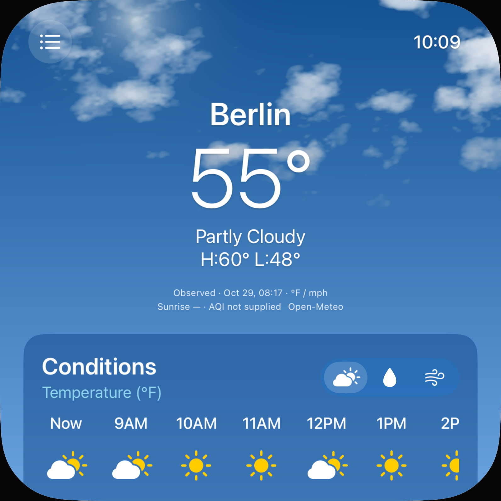
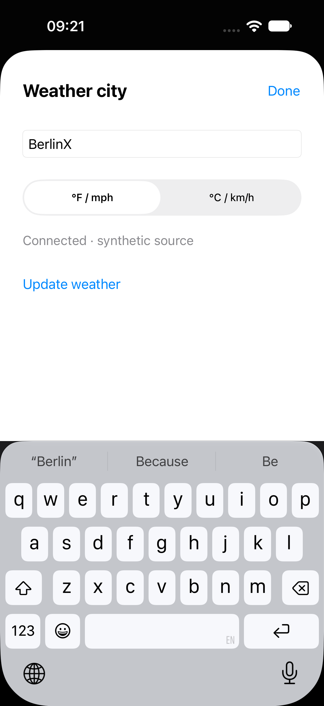

# Wetter-App und Stadtdialog: tatsächliche Trefferflächen

29. Oktober 2026 · weiterer begrenzter Teilfix von [#73](https://github.com/Olli0103/homeview/issues/73), Gesamtissue offen. Der vorherige [Settings-Fix](weather-settings-hit-regions.md) bleibt ein eigener Prüfstand.

Nachtrag: Der unten auf `88b068e` begrenzte Stand öffnete den Quellenlink noch nicht. Der spätere [getrennte OS-Routing-Nachweis](weather-attribution-os-route.md) bestätigt vier tatsächliche Randaufrufe bei unverändertem Produkt. Frühere Ergebnisse bleiben unverändert abgegrenzt.

## Nachgewiesen und korrigiert

Der Quellenlink ist im unveränderten veröffentlichten Produkt nur 8,40 bzw. 17,91 native Punkte hoch. Beide ungefilterten App-Audits melden ihn. Die iPhone-Städtetaste misst 32,76×32,76 Punkte, die Modustasten 32,76×23,94. Auf iPad sind Städte-/Modustasten bereits groß genug und behalten ihre Dimensionen.

Im unskalierten Stadtdialog messen das Feld 34, die Segmente 32 und Done/Update nur etwa 20 Punkte Höhe; Done ist zusätzlich schmaler als 44. Trotzdem sind die ursprünglichen modalen Auditlisten leer. Deshalb werden echte native Rechtecke zusätzlich zum öffentlichen Audit geprüft. Auswahl, Update, Tastatur, Eingabe und Abbrechen funktionierten bereits vorher; ein solcher Funktionalfehler wird nicht erfunden.

| Control | Finaler eigener nativer Nachweis |
|---|---|
| Städte und Moduswahl | Mindestens 44 Punkte; tatsächliche Rand-Berührungen und sichtbare Auswahl bzw. Dialogöffnung |
| Quellenlink | Mindestens 44 Punkte, kein Auditbefund und keine Überlappung mit Modustasten; URL nicht geöffnet |
| Dialogfeld | 44 Punkte vor/nach Tastaturöffnung, reale obere/untere Rand-Eingabe vollständig oberhalb der Tastatur |
| Dialogsegmente | Öffentlicher UISegmentedControl mit 45 Punkten; beide Einheiten per Randaktion wählbar |
| Done und Update | Echte 44-Punkte-Label-Rechtecke; explizites Fixture-Update und Abbrechen ohne stilles Übernehmen des bearbeiteten Orts |

Die Einstellungs- und Dialog-Einheitenwahl teilen denselben öffentlichen nativen Baustein mit getrennten Kennungen. Das native Sheet verwendet 44 direkte Punkte, nicht die Skalierung des darunterliegenden Faces. Keine Daten-/Provider-/Generations- oder Abbruchlogik verändert.

## Sichtprüfung und Quellenzeile

Ein erster größerer Link-Rahmen verschob unnötig das Layout. Übernommen wird stattdessen ein textgroßer Layoutträger mit transparenter erweiterter Link-Trefferfläche. Die sichtbare Quellenzeile behält ihre Geometrie. Alle fünf vermessenen iPad-Städte-/Modus-Rechtecke sind gegenüber dem unangetasteten Vorherstand exakt gleich. Das ist kein Ganzbild- oder Original-Pixel-PASS; Beobachtungszeit und Forecast-Zeitbeschriftungen der Fixtures ändern sich. Auf iPhone benötigt die größere Moduswahl mehr Platz; die Wetterdetails sind weiterhin scrollbar.

## Gebundene Ergebnisse

**Zwölf finale erfolgreiche UI-Ausführungen, sechs eindeutige Methoden je Größe, an denselben 225 Quelleingaben.** Neue App-/Dialogfälle, bisherige Settings-Einheitenwahl, Forecast-/Ortswahl, verspäteter alter Antwortabschluss und zentriertes Demo-Layout bestanden. 26 neue echte Randaktionen, vier bearbeitete Dialogfelder und vier leere ungefilterte App-/Dialog-Auditlisten. 32 native PNGs dekodiert, vier Übersichten und zwei volle fokussierte Aufnahmen gesichtet; zehn eigene Bilder kopiert/zurückgelesen. Fünf SDK-Builds bestanden. 88 Core-/Package-/Testdateien unverändert, kein neuer Core-Lauf.

Die früheren Stände bleiben separat: drei erfolgreiche/fünf fehlgeschlagene UI-Ausführungen. Zusätzlich zu den echten Vorher-Mindestflächen-/Auditfehlern enthielt der erste Test einen ungeeigneten 40-Punkte-Header-Scrollabstand. Vier ursprüngliche und ein späterer iPhone-Helferfehler bleiben ausdrücklich dokumentiert. Der korrigierte Helfer scrollt höchstens achtmal, bis das vollständige natürliche Header-Rechteck sichtbar ist. Mindestgröße, Audits und tatsächliche Randaktionen bleiben unverändert. Der verworfene größere Quellenzeilen-Kandidat bleibt erhalten.

Alle ausgeführten Quell-/Projekt-/Ressourcen-, kompilierten App-/Test-/Launch- und Steuereingaben sind pro Stand archiviert und vollständig zurückgelesen; unveränderte Eingaben und tatsächlich installierte Appdateien geprüft. Keine neue ganze UI-Suite, Hilfsmittel-, Hardware- oder Originalabnahme. Keine reale Wetterverbindung, persönlichen Konten, Home-Anbindung, Aufnahme, Wiedergabe, Systemalarme, Nachrichten oder Anrufe; alle Datenaktionen verwenden den synthetischen Provider.

[Ergebnisse, Geometrien und Bilder](verification/weather-surface-hit-regions.json) · [alle Quellenvarianten](verification/weather-surface-hit-regions-source.json) · [fünf SDKs](verification/weather-surface-hit-regions-platforms.json).

