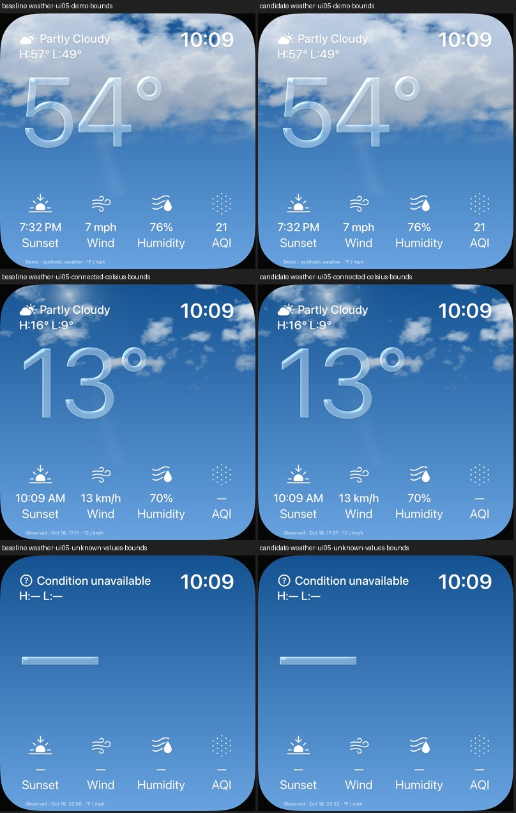

# UI05: obere blaue Wolkenlücke begrenzen

18. Oktober 2026 · [FACE-12 / Issue21](https://github.com/Olli0103/homeview/issues/21).
[Code c99d2764](https://github.com/Olli0103/homeview/commit/c99d2764239b43c0dcff11ba3818ede63b6712b8).
Begrenzte eigene Wolkenillustration, keine vollständige Originalabnahme.

## Korrektur

Eine textfreie obere UI05-Region zeigte im Nachbau eine größere blaue Lücke.
Ein eigener Dichteversatz von 0,035 schließt übermäßige obere Tageslücken;
zwischen y8–22% läuft er weich auf null aus. Die Tages-Schattenbasis steigt
passend zur höheren Dichte von 0,64/0,72/0,83 auf 0,66/0,74/0,85.
Nachtformel, Himmelspalette, 16 Tiefenproben, Windschichtung und Zeitphase,
Glasformel, Daten, Layout und getrennte Lichtspurebene bleiben unverändert.
Keine zusätzlichen Dichteproben, Originalbilder/-shader/-fontkonturen oder Pakete.

## Vor dem ersten Code festgelegte Bildgrenzen

Textfreie Region x46–66%/y2–18%, normiert auf 544 Pixel. Nominelles RGB-Y
(`0,2126R + 0,7152G + 0,0722B`), keine kalibrierte Leuchtdichte und keine echte
Wolken-Segmentierung. Anteile oberhalb 150/170: Abweichung höchstens 8/10 Prozentpunkte;
10./50./90.Perzentil: höchstens 20/12/12 Einheiten Abweichung zur privaten Referenz.
Kontrastspanne90–10 mindestens 65% der Referenz, damit kein flachweißes Füllen besteht.
Beide bereits korrigierten Wolkenregionen behalten ihre 12er-Median- und Kontrastgrenzen;
alle fünf bisherigen Lichtprofile bleiben innerhalb ihrer ursprünglichen Grenzen.

Auf dem iPad steigt der Anteil über 170 von71.1%
auf93.7%, Referenz93.6%.
Das 10. Perzentil steigt von119.9 auf178.9,
Referenz175.3. Auch das iPhone erfüllt sämtliche Grenzen.
Das sind ausschließlich diese nominalen Bildmetriken, **kein Prozentwert für
allgemeine Originaltreue** und kein Farbverwaltungs-/HDR-PASS.

## Exakte Erhaltung und verworfener Versuch

Nacht und null Bedeckung oben94% sowie Demo/Celsius/fehlende Werte im unteren
Tagesbereich y58–94% bleiben RGBA-exakt, null geänderte Pixel auf beiden Geräten.
Die untersten6% mit laufabhängigen Beobachtungs-/Quellenzeiten waren vor dem ersten
Code ausgeschlossen. Keine RGB-Toleranz oder nachträgliche Grenzlockerung.

Der erste Dichteversuch traf die obere Region, verdunkelte jedoch eine zuvor
korrigierte Wolkenregion auf 13,8544 statt höchstens12 Einheiten Medianabweichung.
Er wurde nicht übernommen; Quelle, 24 eindeutige Binär-/Parameter-/Quelldateien und
Fehlerbefund bleiben privat exakt archiviert. Die angeglichene Schattenfarbe erfüllt
denselben unveränderten Vertrag. Piloten zählen nicht zur Abschlussserie.

## Quellengebundene Prüfung

166 Modelltests, 22 gezielte native Fälle (elf je iPad-/iPhone-Simulator), null
Fehler/Skips/XCTest-Runtime-Warnungen und fünf SDK-Builds. Zusätzlich je zwei
Pilotfälle getrennt gezählt. Vorherbilder aus dem bestandenen unmittelbaren
Vorgänger wiederverwendet, kein zusätzlicher Baseline-Abnahmelauf.
Dasselbe gebaute Testbundle und unveränderte UI-Quelle; installierte App-Dateien
auf beiden Geräten SHA-exakt. Alle 36 vollständigen Eingaben unverändert und
privat eindeutig archiviert/bytegeprüft. 143 Quellen vor/nach Prüfungen und gegen
Integrationsbytes exakt; nur WeatherClouds.metal geändert, 142 übrige Dateien bytegleich.

Alle 78 eigenen PNGs (58 Kandidat, 20 vorher) auf 16 unterschiedlichen Kontaktbögen
wirklich gesichtet. iPad-Demobild ganzbildexakt zum bestandenen Pilot.
Bewegung in den festgelegten Himmel-/Glas-ROIs positiv, CLI-Reduce-Motion dort exakt
still; kein neuer tatsächlicher OS-Schalter- oder erodierter Glyphkörper-Nachweis.

[Nachweis](verification/weather-top-clouds.json),
[Quellen](verification/weather-top-clouds-source.json),
[eigene Bilder und Hashes](screenshots/goal-20261018/weather-top-clouds-manifest.json).
Private Originalbilder bleiben privat. Nur synthetische Daten/MockHome; keine echten
Konten, Bibliotheken, HomeKit-Geräte oder Kommunikation.

Exakte Originalwolken/-phase, Schrift, Lichtverdeckung/Brechung, weitere Zustände
und Übergänge, Farbverwaltung/HDR, physische Leistung und Energie bleiben offen.
Fünf SDK-Builds sind keine fünf Plattform-Laufzeitabnahmen. Issue21 bleibt offen;
kein Gesamtsuiten-, vollständiger Original- oder Hardware-PASS.
