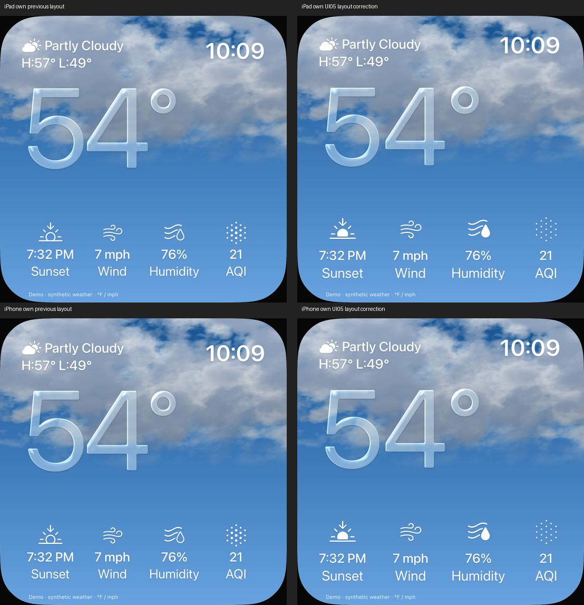

# Wetter-Face: UI05-Geometrie und öffentliche Symbole

18. Oktober 2026 · [FACE-12 / #21](https://github.com/Olli0103/homeview/issues/21).
Separater Layoutschritt nach den [Tageswolkenkörpern](weather-cloud-light.md).
Der genaue Codecheckpoint steht im [quellengebundenen Beleg](verification/weather-ui05.json).

## Korrektur

Die Uhr saß im direkten privaten UI05-Vergleich zu tief, das Gradzeichen war zu
klein und die Detailzeile nach rechts komprimiert. Uhr und Zustandszeile werden
angeglichen; die nahe Temperatur nutzt 241 statt 236 Punkte, das Gradzeichen
86 statt 76 Prozent mit angepasstem Hochstand und Zeichenabstand. Die vier
Detailspalten erhalten mehr horizontalen Raum und getrennten vertikalen Platz
für Symbole, Messwerte und Beschriftung. Keine neue Schrift oder Originalkontur.

Die installierten öffentlichen Systemsymbole wurden separat verglichen:
sunset.fill, humidity.fill und die kleinen gleichmäßigen Punkte von aqi.low
passen näher zum belegten Beispiel. Sie werden zur Laufzeit erzeugt, nicht als
extrahierte Grafik eingebettet. Die Symbole sind dekorativ für Accessibility;
sie behaupten keine gemessene Luftqualitätskategorie. Nur die markierte Demo
enthält den beobachteten Beispiel-AQI 21, verbundene Daten weiterhin „—“.
Das ist keine vollständige VoiceOver- oder Originalzustandsabnahme.

## Prüfung des finalen Stands

139 Modelltests, erneut nach Feature- und Integrationscommit. Fünf gezielte Fälle
je iPad und iPhone, zehn erfolgreiche Ausführungen ohne Fehler, Skips oder
Runtime-Warnungen. Der neue Fall prüft Demo, verbundene Celsiuswerte und unbekannte
Werte: Uhr, Temperatur, alle vier Werte und Beschriftungen liegen vollständig im
nativen Viewport; Uhr und Temperatur überlappen nicht. Weitere Fälle prüfen
Demo/verbundene Werte ohne erfundenen AQI, Glasbewegung/Reduce Motion, Öffnen der
Stadtansicht und das unveränderte zentrierte App-Layout. Alle fünf SDKs bestehen.
Kein neuer vollständiger UI-Suite-PASS. Die älteren Piloten zählen nicht hinzu.

133 Quellen vor/nach Lauf und gegen Feature-/Integrationsbytes identisch.
Nur Faces.swift, WeatherGlass.swift und die UI-Testdatei unterscheiden sich vom
vorherigen Wolkenstand; Shader, Daten- und Kalender-/Albumlogik bleiben gleich.
Die tatsächlichen Bilder beider Größen sind gesichtet. In der vor Auswertung
festgelegten freien Himmelsregion (x 72–92 %, y 20–35 %) ändern sich auf beiden
Geräten exakt null dekodierte RGBA-Kanäle gegenüber dem vorherigen Wolkenstand.
Die bewegte Glasregion ändert sich; Reduce Motion bleibt dort ebenfalls exakt
unverändert. Das ist keine Originalpixelmessung oder kalibrierte Farbabnahme.

[Prüfbeleg mit Digests und Pixelzahlen](verification/weather-ui05.json),
[Quellenmanifest](verification/weather-ui05-source.json),
[Bildmanifest](screenshots/goal-20261018/weather-ui05-manifest.json),
[Herkunft des eigenen Vergleichs](screenshots/goal-20261018/weather-ui05-own-comparison.json).

## Offen

Exakte Schrift, Brechung, Wolken-/Lichtphase, weitere ursprüngliche Temperaturen,
Abstands-/Sprachvarianten, Übergänge und physische Leistung bleiben offen. #21
bleibt offen. Nur synthetische Daten und MockHome; keine echten Konten, Standorte,
Bibliotheken, HomeKit-Geräte, Mikrofone oder Anrufe. Keine Originalbilder veröffentlicht.
