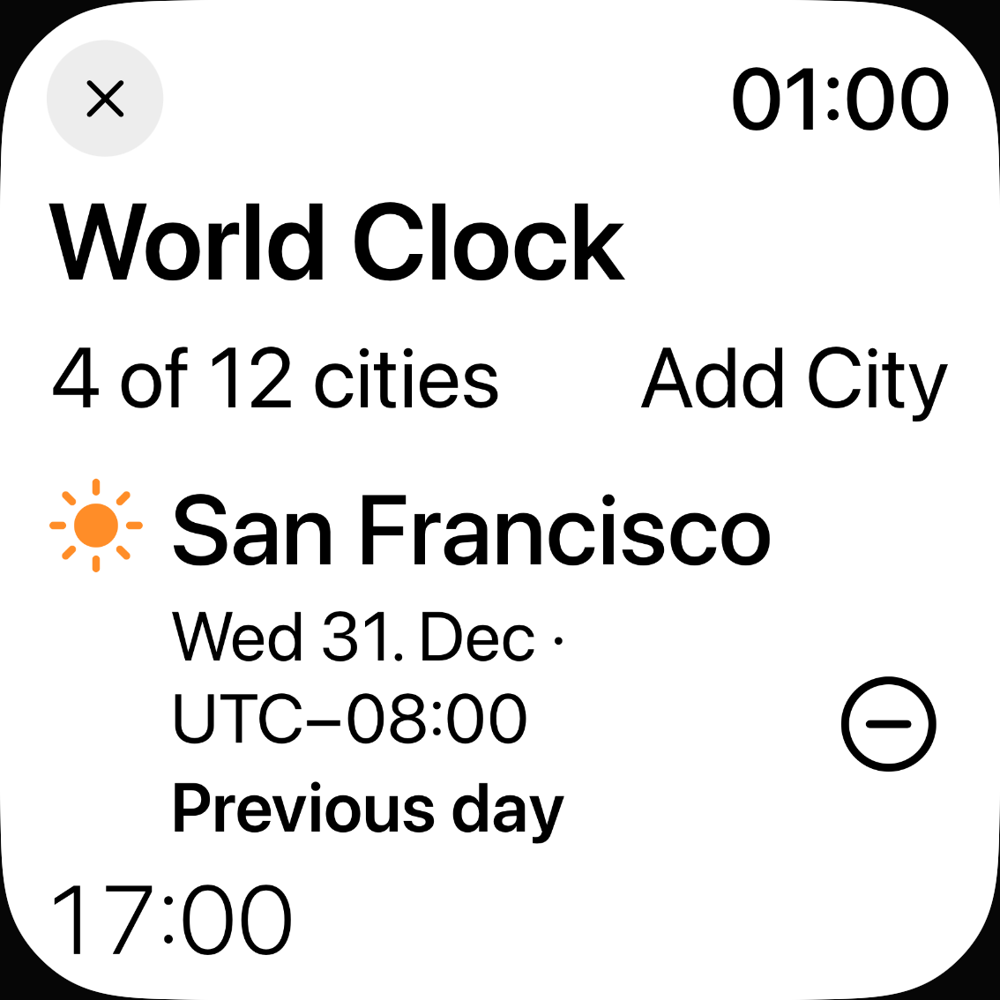
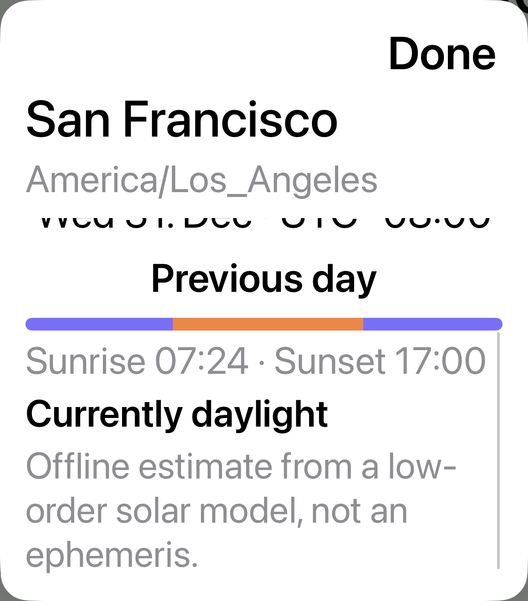

# Weltuhr: Systemschrift in Liste, Städtewahl und Detailblatt

30. Oktober 2026 · begrenzter Teil von [#73](https://github.com/Olli0103/homeview/issues/73); kein Abschluss der Originalreferenz bei [#53](https://github.com/Olli0103/homeview/issues/53).

## Befund und Änderung

**38 native Textausdehnungsbedingungen blieben vorher bei1,00**, während zwei semantische Settings-Kontrollen korrekt wuchsen. Acht Controls haben kein isoliertes AX-Textkind; ihre gepolsterten Rahmen werden nicht als Fontmetrik verwendet. Das native Suchfeld wuchs bereits sichtbar und bleibt unverändert.

Nur `WorldClockView`, `WorldClockDetail` und `DaylightBar` in `Everyday.swift` geändert: **17 lokale skalierende Schriftmetriken**. Bei Accessibility-Größen stehen Stadtinformation und Uhrzeit untereinander, der Root-Hinweis wandert in den Scrollbereich und das native Detailblatt erhält einen Scrollkörper bei stets erreichbarem Done-Header. Seine großen digitalen Ziffern sind auf112 Punkte begrenzt; geprüft ist der feste Fünfzeichenwert17:00. Normale Anordnung, Farben, IANA-/DST-/Datums-/Sonnenberechnung, Datenmodell, Speicherung und Provider unverändert.165 andere Produkt-/Ressourceninputs sowie die Produktdatei außerhalb der Weltuhr bytegleich. Bestehende SwiftUI-Mittel, keine neue Abhängigkeit.

**Aktuell38/38 gemeldete Textausdehnungen grün**, Höhen1,554–14,575-fach einschließlich Umbruch und sichtbarer Fragmentgrenzen. Das sind keine38 verschiedenen neuen Fonts und keine isolierten Schriftfaktoren. Acht fehlende Textkind-Bedingungen bleiben unbewiesen.

## Prüfungen

**18 aktuelle UI-Ausführungen/sieben Methoden bestanden**, null Fehler/Skips: acht Normal-/XXXL-Inventuren auf iPhone18Pro/iPadAir11-inchM4, iOS Simulator27.0/24A434, sowie zehn bestehende Regressionen. London hinzufügen/entfernen und gleicher Vierstädte-Rückweg, tatsächliches natives Detail/Done, Kathmandu mit Bruchstundenoffset und Prozessneustart/Entfernung, Mitternachts-Tageslichtpixel, unbekannter neutraler Sonnenstand versus berechnete Sydney-Darstellung sowie echte OS-Appkarten und genaue Rückkehr der synthetischen Suche/Detail-/Editorblätter. Kein Netz, Konten, Ortung, Systemalarm oder Playback.

**Alle48 normalen nativen RGBA-Paare exakt gleich**, ebenso48 Zielrahmen und tatsächliche Clips:30 Root-Viewports und18 ganze eigene native Sheet-Container. Keine Toleranz, Masken, Registrierung oder Reskalierung. Die beiden Settings-Posen sind enthalten. Die normale Sichtprüfung wird anhand dieser exakten Identität aus vier Root- und zwei nativen Vorher-Kontaktbögen wiederverwendet; nicht als48 neue unabhängige Sichtungen gezählt.

Acht akzeptierte Vorher-Ausführungen über zwei Testpins bei **22 vollständig bytegleichen App-Dateien**. Vier erste native Messläufe scheiterten an nicht endlicher JSON-Geometrie, nicht am Produkt: Der tatsächliche AX-Baum behält Root und Sheet mit doppelten Textlabels. Das Instrument bindet nun den kleinsten endlichen nativen Container mit den eindeutigen Sheet-Zielen Done/Zeit, sucht Texte und Scrollancestor dort und leitet Bildmaßstab/Crop vom endlichen Fenster ab. Ursprüngliche Fehler und Archive erhalten. Historische Runner-Prosa zur äußeren App-Grenze wird nicht umgeschrieben; die getrennte [Quellenklärung](verification/world-clock-dynamic-type.json) benennt die tatsächlich ausgeführten Container-Helper. Eine falsche Nacht-Literalvorgabe wurde bereits vor jeder UI-Ausführung anhand des aktuellen Core-Modells korrigiert; der unbenutzte erste Vorbereitungsbuild bleibt separat erhalten.

235 Inputs je Quellenpin: Root-Vorher `a7610aaa…`, korrigiertes natives Vorher `c80c222b…`, aktuell `db575590…`. Dieselbe korrigierte UITestquelle vor/nach dem Produktfix; keine Änderung unter laufenden Tests. Installierte App-/Runnerbytes vor/nach Läufen geprüft. **Fünf aktuelle SDKs/73 Outputs und sechs Tooling-Tests bestanden.** 89 Core-/Package-/Coretestinputs zum historischen405-Test-Stand `0c42086` unverändert; kein neuer Core-Suitelauf.

Gesamthistorie30 UI-Ausführungen:26PASS und vier erhaltene Instrumentfehler. Die38 roten Vorher-Schriftbedingungen sind davon getrennt.14 UI-Inputarchive und das SDK-Archiv vollständig zurückgelesen.430 native PNGs dekodiert; zwölf Vorher-, sechs neue große eigene Viewport-Kontaktbögen, vier Regressionstafeln und zwei zusätzliche native Vorher-Vollbilder tatsächlich gesichtet. Je96 ganze Bildschirmduplikate der Vorher-/aktuellen Inventuren nur dekodiert, nicht einzeln gesichtet.14 eigene unveränderte native Bilder mit Herkunft/SHA-256 veröffentlicht. Sechs Schriftcontroller/18 Präferenzwrites einschließlich Rückstellungen stellen jeweils Original `large` wieder her und lesen es zurück.

## Offene Grenzen

Gespeicherte Scrollposen zeigen abgeschnittene Nachbar- und teilweise Textfragmente. Ein AX-Rechteck innerhalb eines rechteckigen Clips ist kein vollständiger Glyphen-/Literal-/Absatz-Lesenachweis; keine pauschale Lese-, native Hilfsmittel- oder größte-Schrift-Kontrastabnahme. Farben unverändert. Keine neue Originalgeometrie, Sonnenmodell-Genauigkeit, Bewegung, akustische oder physische Abnahme.

Der aktuelle UI-Test-App-Lane enthält19 Dateien gegenüber22 im Standard-iOS-SDK-Paket. Drei fehlende UI-SSU/NLU-Dateien bleiben ausdrücklich getrennt; kein neuer Shortcut-Paket-/OS-Aufruf-PASS. Leere strukturierte Runtime-Warnungen beseitigen nicht die erhaltenen rohen AX-Loader-/`noURL`-/Remote-AX-Meldungen.

**#53 und #73 bleiben OPEN/partial/parity=false; ursprüngliche Kriterien unverändert.** Home-Sperre, Geräte-/Signing-Pause und Snoopy-Ausschluss bestehen. Der Gesamtauftrag läuft weiter.

[Quellen, Messungen und Archive](verification/world-clock-dynamic-type.json) · [Eigene native Bilder/SHA-256](verification/world-clock-dynamic-type-images.json).
